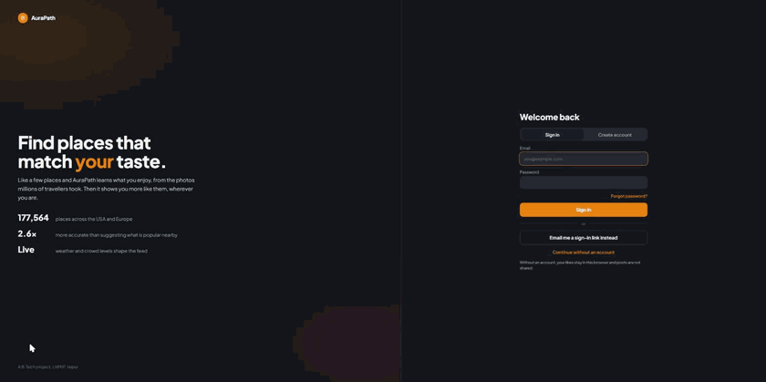

# AuraPath

**Aesthetic-driven place recommendation from geotagged photos.**

AuraPath learns what kind of places a person likes to photograph and recommends places they have not been to
yet. It combines visual embeddings of 3.7 million Flickr photos, soft "aesthetic" clusters of places, geography
and popularity in a single ranking model, and serves it through a live swipe-style web app.

[](https://python.org)
[](https://pytorch.org)
[](https://react.dev)
[](https://fastapi.tiangolo.com)
[](LICENSE)

**[Live demo →](https://recommendation-system-gray-seven.vercel.app)** &nbsp;(the free API sleeps when idle;
the first load can take up to a minute)

<p align="center">
  
</p>

## Highlights

- **2.6× the strongest baseline** on next-place prediction: HR@10 0.175 when ranking a user's held-out next
  visit against all 177,564 places, versus 0.068 for "most popular within 25 km".
- **Above the published GETNext numbers** on the public Foursquare NYC benchmark (Acc@1 0.267 vs 0.2435,
  MRR 0.399 vs 0.362), using GETNext's own split and protocol.
- **Cold start from three likes.** Taste is built from liked places instead of a photo history; three likes
  put the model 60% ahead of the best baseline, and liked places work as well as a user's own photos.
- **Live app** with a login page, swipe cards, live weather and crowd context, profiles, a shared posts feed
  and *People like you* taste matching.

## Features

| | |
|---|---|
| **Swipe recommendations** | A map with one recommended place at a time. Like, skip, save or undo; the next cards adapt to every action. |
| **Any area** | 3,464 towns across the USA and Europe, a 5–60 km radius, six scenery types, moods and a *Hidden gems* mode. |
| **Live context** | Current weather from Open-Meteo: in rain, cold or heat, places people photograph in those conditions come first. *Quieter now* demotes places that are busy at this time of day and week. |
| **Rich cards** | Name, town, tags, best months, visitor count and up to six photos per place, one per photographer, ranked by how typical of the place they look. |
| **Accounts** | Email and password or email-link sign-in, a profile with a home area and moods, likes synced across devices. Guests can use everything without an account. |
| **People like you** | Other users ranked by how close their taste is to yours, with their recent likes you have not seen. |
| **Community** | Short posts about places, shown to everyone in a shared feed. |

## How it works

```
Flickr photos ──► ResNet50 ──► quintuplet projector ──► 256-d photo embeddings
                                                            │
        DBSCAN + density-peak splitting ──► 177,564 places ◄┘ (mean of photo embeddings)
                                                            │
                          fuzzy C-means ──► 6 soft aesthetic clusters per place
                                                            │
   user taste (photos or liked places) ──► two-tower ranker + distance, density, popularity ──► top-k places
```

1. **Visual encoder.** A pre-trained ResNet50 gives a 2048-d embedding per photo; a projector trained with a
   quintuplet loss maps it to 256-d.
2. **Places.** Photos are grouped into places by DBSCAN on coordinates, and oversized groups are split by
   density peaks (3.74 million photos from the YFCC100M subset, USA and Europe).
3. **Aesthetic clusters.** Fuzzy C-means gives each place a soft membership in six clusters, for example 60%
   historic and 40% scenic.
4. **Ranking.** A two-tower network with an interaction layer scores (user, place) pairs, together with
   distance, local density and popularity features, trained with a sampled-softmax ranking loss.
5. **Serving.** The trained model is exported to a numpy-only engine (no PyTorch at inference) that ranks a
   whole area in under 0.2 s on a free 512 MB instance.

| Cluster | Label | Places |
|---|---|---|
| 0 | Live Events & Recreation | 21,983 |
| 1 | Urban & Street Architecture | 29,928 |
| 2 | Historic & Rural Heritage | 22,883 |
| 3 | Scenic Nature & Waterscapes | 28,920 |
| 4 | Nightlife & Social Scenes | 33,361 |
| 5 | Green Nature & Wildlife | 32,770 |

## Results

### Next-place prediction (Flickr, YFCC100M)

14,955 test users, each with one held-out last visit, ranked against all 177,564 places.

| Method | HR@10 | HR@20 | NDCG@20 | MRR |
|---|---|---|---|---|
| **AuraPath** | **0.175** | **0.232** | **0.118** | **0.092** |
| Popular within 25 km | 0.068 | 0.109 | 0.046 | 0.033 |
| Nearest place | 0.058 | 0.100 | 0.039 | 0.027 |
| Popularity | 0.010 | 0.018 | 0.007 | 0.005 |

- Precision@10 +155% and MAP +178% over the strongest baseline.
- With a stated destination (trips to a new area, 30 km radius): HR@10 0.456 against 0.424 for popularity.
- Mean absolute error of visit probability is 52% below popularity.

### Public benchmark: Foursquare NYC

Same ranker, with a category embedding in place of photos and three count features (transitions from the
current place, the user's visit counts, time of day). GETNext's split and protocol, mean of 3 seeds.

| Method | Acc@1 | Acc@5 | Acc@10 | MRR |
|---|---|---|---|---|
| **AuraPath** | **0.267** | **0.558** | **0.677** | **0.399** |
| GETNext (published) | 0.2435 | 0.5089 | 0.6143 | 0.3621 |
| User's own check-in counts | 0.234 | 0.525 | 0.648 | 0.367 |

### Taste matching (*People like you*)

3,000 real Flickr users with at least 20 places each. Each user's places are split in half at random, and one
half is used to find the other among all users.

| Test | Taste matching | Random |
|---|---|---|
| Same person in the top 10 of 3,000 | **25.6%** | 0.3% |
| Same person ranked first among users in the same city | **35.6%** | 2.7% |
| Same person in the top 10 from only 3 / 5 / 10 likes | 6.4% / 9.9% / 15.1% | 0.3% |
| Top-5 matches share the user's main scenery type | **79.8%** | 33.7% |

## Evaluation protocol

- Each user's visits are ordered by time: the last visit is the test target, the one before it is validation,
  everything earlier is training.
- User and place embeddings are built from training photos only.
- The model ranks the target against **all** places, with no sampled candidate pool.
- Every result is reported next to popularity, nearest-place and popular-within-25 km baselines.
- Hyperparameters are tuned on validation; the test set is evaluated once per chosen model.

## Tech stack

| Layer | Technology |
|---|---|
| Model training | PyTorch, scikit-learn, NumPy, pandas (NVIDIA DGX) |
| Inference API | FastAPI + NumPy on Render |
| Web app | React 19, Vite, MapLibre GL on Vercel |
| Accounts and data | Supabase (Postgres with row-level security, Auth) |
| Live context | Open-Meteo weather API |

## Getting started

### Run the app locally

```bash
git clone https://github.com/AyushModi-byte/Smart-Recommendation-System.git
cd Smart-Recommendation-System

# API: download the 98 MB model and data bundle, then start the server on port 8000
pip install -r server/requirements.txt
python scripts/fetch_swipe_bundle.py --url https://github.com/AyushModi-byte/Smart-Recommendation-System/releases/download/swipe-bundle-v1/bundle_swipe.zip
uvicorn server.main:app --port 8000

# Web app (second terminal): opens on http://localhost:5173
cd web
npm install
npm run dev
```

Accounts are optional. To enable them, create a Supabase project, run `supabase/schema.sql`,
`supabase/002_people.sql` and `supabase/003_grants.sql` in its SQL editor, and put the project URL and
publishable key in `web/.env.local`:

```
VITE_SUPABASE_URL=https://<project>.supabase.co
VITE_SUPABASE_ANON_KEY=sb_publishable_...
```

### Train and evaluate the model

The training data (photo embeddings and metadata, about 70 GB) is not distributed with the repository.

```bash
pip install -r requirements.txt

# 1. split oversized places, then build the time-based split with train-only embeddings
python training/00a_split_places.py --brain brain
python training/00b_prepare_all_photos.py --brain brain --out data_v4 --places _v2

# 2. train: a 2-minute smoke run first, then the full run
python training/01_train.py --data data_v4 --name smoke --smoke
python training/01_train.py --data data_v4 --name p1_split --feat-v 1

# 3. evaluate once on the test set, against the baselines
python training/02_evaluate.py --data data_v4 --run p1_split

# 4. destination mode, content ablation, MAE, taste matching, app bundle
python training/03_destination_eval.py --data data_v4 --run p1_split --radius 30
python training/04_ablate_content.py   --data data_v4 --run p1_split
python training/13_mae_benchmark.py    --data data_v4 --run p1_split
python training/19_people_match.py     --data data_v4
python training/06_export_bundle.py    --data data_v4 --run p1_split --brain brain --out bundle --places _v2
python training/16_export_swipe.py
```

### Foursquare NYC benchmark

```bash
python -m benchmarks.foursquare.run --seed 0 --extra trans,freq,time
```

## Repository structure

```
training/     model pipeline: data preparation, training, evaluation, export
server/       FastAPI + NumPy inference engine for the web app
web/          React + MapLibre web app
supabase/     database schema and row-level security policies
benchmarks/   Foursquare NYC next-place benchmark
app/          NumPy-only inference shared by the exporters, and a Gradio demo
notebooks/    exploratory notebooks: feature extraction, clustering, early models
scripts/      bundle packaging, server sync, local tunnel
results/      benchmark result tables
runs/         one folder per experiment: config, history, metrics (JSON)
docs/         data manifest, results log, deployment and server workflow
render.yaml   Render blueprint for the API
```

## Project status

| Component | Status |
|---|---|
| Ranking model and evaluation pipeline | Complete |
| Proposal experiments: quintuplet loss, attention pooling, ICA + fuzzy C-means, weather, time, crowd, mood, collaborative filtering | Complete |
| Public benchmark (Foursquare NYC) | Complete |
| Web app, API and accounts | Live |
| *People like you* taste matching | Live |
| Social influence clusters of users | Planned |

## Authors

**Ayush Modi** and **Anurag Yadav**, B.Tech Computer Science.

```bibtex
@misc{aurapath2026,
  title  = {AuraPath: Aesthetic-Driven POI Recommendation from Geotagged Photos},
  author = {Modi, Ayush and Yadav, Anurag},
  year   = {2026}
}
```

Photos come from the YFCC100M dataset (Flickr, Creative Commons licences). Released under the
[MIT License](LICENSE).
